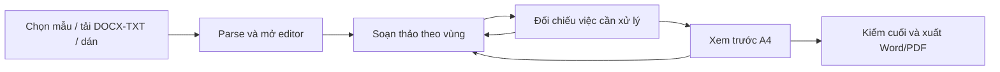

# Đề xuất thiết kế lại toàn bộ giao diện Docs-ND30

> **Phương án chốt:** [Docs-ND30 — phương án sản phẩm và giao diện cuối cùng](./2026-10-15-final-product-interface-plan.md).

> **Đánh giá cập nhật:** [Nghiên cứu dự án GitHub và phương án thiết kế sửa lại](./2026-10-15-github-reference-reassessment.md) điều chỉnh bố cục mặc định thành hai cột và giới hạn của bản xem DOCX. Dùng tài liệu cập nhật khi quyết định triển khai.

**Ngày:** 15/10/2026  
**Cơ sở quan sát:** ứng dụng local `4bb714e`, cửa sổ 1265 × 744, 900 × 700, 620 × 800 và 390 × 844; tài liệu DOCX thử tổng hợp 7 khối; các màn hình bắt đầu, tải tệp/đối chiếu, dán văn bản, soạn thảo, phụ lục, kiểm tra thể thức, Preview mở rộng và Lịch sử.  
**Phạm vi:** đề xuất giao diện, điều hướng và hành vi nhìn thấy. Không sửa giao diện ứng dụng trong tài liệu này. AI Studio/GitHub `main` đang ở `e58fd6e`, khác bản local, nên đề xuất lấy bản local làm hiện trạng.

**Bản xem trực quan:** [Mở phác thảo HTML](./2026-10-15-ui-concept.html). Có màn hình bắt đầu, soạn thảo, Preview và drawer Lịch sử; dữ liệu minh họa, chưa xử lý tệp hay xuất văn bản.

## 1. Mục tiêu sử dụng

Nhân viên nội bộ có thể bắt đầu bằng mẫu, DOCX/TXT hoặc văn bản dán; thấy ngay tài liệu để sửa; biết chính xác điểm nào cần đối chiếu nguồn; xem A4 và xuất Word/PDF mà không nhầm bản nháp với bản đã rà soát. Luồng chính chỉ có hai không gian: **Soạn thảo & đối chiếu** và **Xem trước & xuất**. Lịch sử, trợ giúp và công cụ chuyên sâu là chức năng phụ, không là một bước bắt buộc.

## 2. Những điều thấy trực tiếp cần thay đổi

| Khu vực hiện tại | Quan sát bằng mắt | Quyết định thiết kế |
| --- | --- | --- |
| Màn hình đầu | 10 thẻ mẫu chiếm gần hết viewport 1265 px; tải tệp và dán văn bản phải cuộn xuống. Tại 390 px, các mẫu nối thành nhiều màn hình. | Chỉ hiển thị ba cách bắt đầu trong viewport đầu; thư viện mẫu mở khi người dùng chọn `Chọn mẫu`. |
| Header/menu | Tên app, slogan, ba tab, điểm %, Word/PDF cạnh nhau. Ở 620 px header thành ba hàng, tại 390 px nút và nhãn dồn chật. | Header một hàng ngắn: tên tài liệu, trạng thái lưu, menu `⋯`; hai tab chính ở hàng kế hoặc navigation compact. Xuất tệp đặt trong Preview. |
| Sau tải tệp | Vùng xanh lớn, 11 trường trích xuất và checkbox đối chiếu ở trên; editor nằm nhiều cuộn bên dưới. Cùng một thông tin sửa được trong review và editor. | Editor xuất hiện ngay sau parse; panel đối chiếu theo ngữ cảnh đặt cạnh editor hoặc mở từ drawer. Chỉ một ô sửa cho mỗi trường. |
| Editor | Toolbar có nhiều lệnh chèn phần đầu ngay trên nội dung thân. Tại 620 px toolbar trải 4 hàng, đẩy nội dung viết xuống. | Toolbar thường trực chỉ giữ định dạng văn bản thiết yếu; lệnh khối văn bản theo menu `Chèn`; profile công ty nằm trong mục Phần đầu. |
| Phần cuối/phụ lục | Chữ ký, nơi nhận tách ở cuối trang dài; phụ lục hiện ô HTML thô và nút xóa nhỏ. | Điều hướng vùng tài liệu luôn thấy được; phụ lục dùng editor trực quan, có hoàn tác/xác nhận xóa. |
| Preview | Chế độ `Engine Word Real` và `Canvas CSS` lộ ra như lựa chọn người dùng; Preview có hai lớp cuộn, nút Word/PDF lặp ở header và cuối; mở rộng A4 tạo thêm một modal. Ở 390 px A4 thu 45%, khó đọc và có phần bị cắt ngang. | Chỉ một chế độ Preview theo DOCX, một thanh zoom/trang, một vùng xuất. Khi hẹp: `Vừa trang` để tổng quan và `Đọc 100%` để cuộn ngang/dọc có kiểm soát. |
| Lịch sử | Một tab riêng nhưng chỉ có danh sách checkpoint thưa và khoảng trắng lớn; bản nháp không được lưu sau reload. | Nút `Lịch sử` mở drawer có thời điểm, loại thay đổi, xem khác biệt và khôi phục. Chỉ báo lưu thật xuất hiện cạnh tên tài liệu. |
| Kiểm tra | Header ghi `Thể thức: 78%`, modal lại ghi 7/9 trường và 393 quy tắc chưa đánh giá. Cảnh báo không dẫn người dùng tới ô cần sửa. | Đổi thành số việc rõ ràng: `2 cần sửa · 1 cần đối chiếu · 393 chưa tự kiểm`; mỗi mục mở đúng vị trí. Không có điểm phần trăm tổng. |
| Thông báo | Banner thành công còn tồn tại khi chuyển tab, lấy diện tích màn hình; chữ nhỏ. | Toast ngắn cho thành công; lỗi hoặc việc phải xử lý nằm trong panel bền vững, có liên kết tới ô. |

## 3. Kiến trúc thông tin và menu mới

```text
Docs-ND30
├─ Soạn thảo & đối chiếu      ← màn hình làm việc chính
│  ├─ Nguồn: mẫu / DOCX-TXT / dán văn bản
│  ├─ Cấu trúc: phần đầu / nội dung / phần cuối / phụ lục / khác
│  ├─ Editor
│  └─ Việc cần xử lý / đối chiếu nguồn
├─ Xem trước & xuất           ← A4 duy nhất, kiểm cuối, Word/PDF
└─ Tiện ích (không phải tab bước)
   ├─ Lịch sử & khôi phục
   ├─ Quy tắc / cách kiểm
   ├─ Trợ giúp
   └─ AI và HTML nâng cao
```

- **Header:** `Docs-ND30` hoặc tên tài liệu khi đang soạn; ngay cạnh là `Đã lưu lúc…`, `Đang lưu…` hoặc `Lỗi lưu`. Bên phải là `Lịch sử`, `Trợ giúp`, `⋯`. Không đặt nút xuất ở mọi màn hình.
- **Điều hướng chính:** hai tab có nhãn động từ và trạng thái: `1 Soạn thảo & đối chiếu`, `2 Xem trước & xuất`. Tab 2 luôn vào được để xem, nhưng nếu có việc chưa xong, nêu rõ `Bản nháp` ở Preview; không khóa người dùng vô lý.
- **Điều hướng trong mục 1:** danh sách vùng `Phần đầu`, `Nội dung`, `Phần cuối`, `Phụ lục`, `Chưa phân loại`, mỗi vùng có số việc cần xử lý. Đây là điều hướng trong cùng một bước, không phải wizard nhiều bước.
- **Trạng thái tài liệu:** chip bằng chữ và biểu tượng: `Chưa đối chiếu`, `Cần sửa 2`, `Đã đối chiếu nguồn`, `Bản nháp`. Màu chỉ bổ trợ cho nhãn.

## 4. Bố cục đề xuất theo màn hình

### A. Chưa có tài liệu: bắt đầu trong một viewport

```text
┌ Docs-ND30 ─────────────────────────────── Lịch sử  Trợ giúp ─┐
│  Soạn thảo & đối chiếu          Xem trước & xuất             │
├───────────────────────────────────────────────────────────────┤
│  Bắt đầu văn bản                                                   │
│  Chọn một cách; có thể thay nguồn sau khi lưu bản nháp.            │
│                                                                   │
│  [ Tải DOCX/TXT ]   [ Chọn mẫu ]   [ Dán văn bản ]                │
│                                                                   │
│  Văn bản hành chính: profile công ty mặc định                     │
│  Văn bản Đảng: chọn rõ chế độ HD 05 khi cần                       │
└───────────────────────────────────────────────────────────────┘
```

Không nạp sẵn Quyết định có các placeholder rồi hiển thị 56% như một tài liệu sắp hoàn thành. Nếu có bản nháp đã lưu, hiển thị `Tiếp tục bản nháp` trên ba lựa chọn. Chọn mẫu mở thư viện có tìm kiếm, nhóm `NĐ 30`/`HD 05`, mô tả ngắn và bản thu nhỏ hoặc cấu trúc mẫu; lần chọn đầu tiên không cần modal xác nhận. Tải tệp hiển thị đúng định dạng hỗ trợ và kích thước tối đa; chỉ ghi “kéo thả” khi thao tác đó thực sự hoạt động.

### B. Có tài liệu: không gian soạn thảo

```text
┌ BIÊN BẢN 12/BB-HTMB ─ Đã lưu ───── Lịch sử  ⋯ ────────────────┐
│ Soạn thảo & đối chiếu            Xem trước & xuất              │
│ Nguồn: 01_BienBan.docx · NĐ 30 · 7 khối   [Đổi nguồn]          │
├──────────────┬──────────────────────────────┬───────────────────┤
│ CẤU TRÚC    │ BIÊN TẬP                     │ CẦN XỬ LÝ        │
│ Phần đầu  1 │ Số, ngày, cơ quan, trích yếu  │ 2 việc            │
│ Nội dung  0 │ ──────────────────────────── │ • Nơi nhận?      │
│ Phần cuối 1 │ Thanh định dạng ngắn          │ • Chữ ký nguồn   │
│ Phụ lục   0 │ Nội dung văn bản              │                   │
│ Khác      0 │                              │ [Xem khối gốc]   │
├──────────────┴──────────────────────────────┴───────────────────┤
│ Đã lưu · 2 việc cần xem                 [Xem trước bản nháp]   │
└────────────────────────────────────────────────────────────────┘
```

- Nguồn là snapshot chỉ đọc; bản đang soạn là bản làm việc. Trong panel việc cần xử lý, mỗi thẻ cho biết **nguồn nói gì**, **bản đang soạn là gì**, lý do cần rà soát và `Tới trường này`. Không đặt bản sao 11 ô trích xuất trên editor.
- Sau parse, tự điều hướng đến vùng có vấn đề đầu tiên hoặc đầu editor; giữ chip tên tệp và số khối. Dải tóm tắt `7 khối · 0 phụ lục · 2 việc cần đối chiếu` chiếm một hàng, thay cho banner xanh dài.
- `Phần đầu` hiển thị profile công ty là mặc định, danh tính cơ quan cố định được trình bày như thông tin nền; số/ký hiệu, ngày, loại, trích yếu được ưu tiên. Chọn profile khác trong menu `Thiết lập phần đầu`, không cần một khối giải thích lớn thường trực.
- `Nội dung` chiếm phần rộng nhất. Toolbar chỉ giữ Undo, định dạng chữ, căn đoạn, danh sách, bảng; `Chèn` mở các khối như căn cứ, điều, chữ ký. Tên kỹ thuật `Tiptap` và `Mã HTML` ở `Nâng cao`.
- `Phần cuối` đặt chữ ký, người ký, nơi nhận cạnh nhau ở desktop; nguồn thiếu phải hiển thị `Không có trong tệp gốc`, không mặc định một nội dung khác.
- `Phụ lục` có danh sách và editor trực quan riêng, cho phép tiêu đề, dòng kèm theo, đoạn/bảng; `Xóa` cần hoàn tác hoặc xác nhận. Mỗi phụ lục có trạng thái đối chiếu riêng.

### C. Xem trước & xuất

```text
┌ BIÊN BẢN 12/BB-HTMB ─ Bản nháp ───────────────────────────────┐
│ [← Tiếp tục soạn]  Xem trước & xuất   Trang 1/2  [− 100% +] │
├────────────────────────────────────────────┬───────────────────┤
│                                            │ KIỂM TRA CUỐI     │
│                GIẤY A4                     │ 2 việc cần xem    │
│                                            │ [Sửa trích yếu]   │
│      chỉ một vùng cuộn của tài liệu        │ [Sửa nơi nhận]   │
│                                            │                   │
│                                            │ [Xuất Word nháp]  │
│                                            │ Xuất PDF khi sẵn  │
└────────────────────────────────────────────┴───────────────────┘
```

- Preview dùng bản kết xuất tương ứng với tệp sẽ tải; không lộ tên engine. Một thanh công cụ: `Vừa trang`, `100%`, `Trang trước/sau`, `In`. Không thêm modal A4 thứ hai cho cùng việc; chế độ toàn màn hình chỉ mở rộng cùng một viewer.
- Bảng kiểm cuối dùng tên mục và nút `Sửa` quay đúng vùng editor, không ép người dùng nhớ vị trí. Hiển thị rõ `Bản nháp` khi còn placeholder, vùng chưa đối chiếu hoặc lỗi; nút xuất nói đúng loại tệp (`Xuất Word nháp`/`Xuất Word`). PDF là hành động phụ khi đã hoạt động và được kiểm bằng mắt.
- Với 390–620 px, giấy thu nhỏ là **tổng quan trang**, không phải chế độ đọc. Có nút `Đọc 100%` và khả năng chuyển trang; cảnh báo khi một phần giấy đang ngoài khung. Không để giấy bị cắt mà người dùng không biết.

### D. Lịch sử và kiểm tra

- `Lịch sử`: drawer 320–400 px, mỗi checkpoint có thời gian, nguồn thay đổi, nhãn `trước khi đổi mẫu`/`sau nhập`, xem tóm tắt và khôi phục. Nội dung đang sửa hiện là `Bản hiện tại`, không bị lẫn với checkpoint. Trạng thái lưu phải phản ánh lưu bền thực tế.
- `Kiểm tra`: drawer có 4 nhóm theo thứ tự **Cần sửa**, **Cần người đối chiếu**, **Chưa kiểm tự động**, **Đã đạt**. Mỗi mục có tác động, vị trí và cách xử lý. Mã quy tắc và trích dẫn nằm ở `Chi tiết`. Không dùng điểm % cho 435 quy tắc chưa kiểm.
- Lỗi nhập/thiếu trường: một tóm tắt ở đầu vùng có liên kết đến từng ô, cộng thông báo sát ô. Khi sửa xong, trạng thái cập nhật tại chỗ. Thông báo thành công ngắn, không đeo bám qua tab.

## 5. Workflow và microcopy



| Hiện nay | Đề xuất | Lý do |
| --- | --- | --- |
| `Lựa chọn A/B/C` | `Chọn mẫu`, `Tải tài liệu`, `Dán văn bản` | Động từ dễ quét, bỏ ký hiệu làm người dùng tưởng có thứ tự bắt buộc. |
| `Đã đưa vào soạn thảo bên dưới` | `Đã mở tài liệu. Có 2 mục cần đối chiếu.` | Nêu kết quả và việc tiếp theo; không bắt tìm “bên dưới”. |
| `Trích xuất (high)` | `Nhận diện từ tệp · Cần xác nhận` hoặc `Đã đối chiếu` | Dùng ngôn ngữ người dùng; độ tin cậy kỹ thuật nằm trong chi tiết. |
| `Thể thức: 78%` | `2 việc cần xử lý` | Số việc có thể hành động, tránh hiểu nhầm về tuân thủ. |
| `Lưu thay đổi & Xem trước` | `Xem trước` + chỉ báo `Đã lưu` | Tách hành động chuyển màn hình khỏi trạng thái lưu. |
| `Engine Word Real / Canvas CSS` | Ẩn; nếu cần thì `Bản xem Word` trong thông tin kỹ thuật | Không chuyển lựa chọn triển khai cho người dùng cuối. |

Trạng thái cần có: `Đang đọc tệp` (tiến độ/đang xử lý), `Không đọc được` (lý do và cách thử lại, giữ tài liệu cũ), `Đã đọc · cần đối chiếu`, `Đã đối chiếu`, `Có thay đổi sau đối chiếu`, `Đang lưu`, `Lỗi lưu`, `Bản nháp`, `Sẵn sàng xuất`. Chỉ một hành động chính ở mỗi vị trí; AI là tùy chọn nâng cao.

## 6. Màu sắc, chữ và khoảng cách

Đây là **palette đề xuất cho giao diện**, không thay màu chữ/khổ/tiêu ngữ của văn bản A4. Dùng xanh dương cho điều hướng và CTA chính; xanh lá chỉ báo thành công; vàng cho việc cần đối chiếu; đỏ cho lỗi. Không dùng đỏ PDF như một CTA ngang hàng với xanh Word.

| Vai trò | Màu | Cách dùng |
| --- | --- | --- |
| Chữ chính | `#101828` | Tiêu đề, nội dung. |
| Chữ phụ | `#475467` | Nhãn phụ, mô tả. |
| Nền app / panel | `#F8FAFC` / `#FFFFFF` | Phân lớp nhẹ, giấy A4 vẫn trắng riêng. |
| Xanh hành động | `#175CD3` | Tab đang chọn, CTA chính, liên kết và focus. Chữ trắng trên màu này khoảng 5.99:1. |
| Xanh thành công | `#067647` | Chỉ báo đã lưu/đã đối chiếu; chữ trắng khoảng 5.69:1. |
| Vàng cần xem | `#B54708` trên `#FFFAEB` | Cảnh báo có thể xử lý; tương phản khoảng 5.20:1. |
| Đỏ lỗi | `#B42318` | Lỗi chặn và thao tác xóa; chữ trắng khoảng 6.57:1. |
| Viền ô nhập | `#8A94A6` trên trắng | Viền đủ rõ (khoảng 3.06:1); viền trang trí có thể nhạt hơn. |

- Font giao diện: hệ thống/Segoe UI; tiêu đề màn 24 px, tiêu đề vùng 18 px, chữ nhập/nội dung 16 px, nhãn phụ 14 px, metadata tối thiểu 12 px. Giữ Times New Roman trong tài liệu A4, không dùng nó cho giao diện.
- Grid 8 px; khoảng cách vùng 24 px; card 16–24 px; ô nhập cao ít nhất 40–44 px; nút và tab tối thiểu 40 px cao. Focus ring rõ, trạng thái không chỉ dựa vào màu.
- Kiểm thử tương phản trên tổ hợp cuối cùng: WCAG 2.2 yêu cầu 4.5:1 cho chữ thường, 3:1 cho dấu hiệu giao diện; vùng bấm tối thiểu 24 × 24 CSS px hoặc khoảng cách tương đương. Các nút chính ở đề xuất lớn hơn mức tối thiểu. Các tỷ lệ màu ở bảng được tính trên cặp màu nêu rõ, chưa thay cho audit toàn bộ màn hình.

## 7. Responsive

| Chiều rộng | Bố cục |
| --- | --- |
| `≥ 1280 px` | Cấu trúc 200–220 px, editor co giãn tối thiểu 620 px, panel việc cần xử lý 280–320 px. Header một hàng. |
| `768–1279 px` | Cấu trúc thu thành rail/nút; editor chiếm phần chính; panel việc cần xử lý là drawer. Preview có A4 và bảng kiểm thu gọn. |
| `< 768 px` | Một cột, hai tab chính ngắn, điều hướng vùng dưới dạng dropdown; editor full width; toolbar một hàng có `Thêm`; review và lịch sử là drawer toàn màn hình. Preview `Vừa trang` + `Đọc 100%`. |

Ưu tiên kiểm nghiệm thực tế tại **620 px** vì AI Studio có thể hiển thị ứng dụng trong panel hẹp; tại **390 px** vì bố cục hiện tại co xuống mức khó đọc. Trên cửa sổ nhỏ, tài liệu A4 chỉ là bản xem, người dùng vẫn sửa ở editor với cỡ chữ giao diện 16 px.

## 8. Điều kiện nghiệm thu thiết kế với người dùng cuối

1. Ba cách bắt đầu xuất hiện trong viewport đầu ở 1265, 900, 620 và 390 px; không phải đi qua 10 mẫu để tìm nút tải tệp.
2. Sau khi chọn DOCX/TXT, editor và số việc cần đối chiếu hiện ngay; một trường chỉ có một ô sửa trong bản làm việc; nút `Tới trường` đưa đúng vị trí.
3. Người dùng nhận ra tài liệu đang là bản nháp hay đã đối chiếu mà không mở modal; mỗi trạng thái có chữ, biểu tượng và màu.
4. Không có menu hoặc nút xuất trùng trong cùng màn hình; mọi hành động có nhãn mô tả kết quả. Lỗi xuất hoặc tải tệp có thông báo rõ và giữ dữ liệu đã nhập.
5. Tại 620/390 px, header không thành ba hàng cố định; editor không có toolbar bốn hàng; không có cuộn ngang toàn trang. Preview có lựa chọn đọc ở 100% và chỉ rõ vùng đang xem.
6. Người dùng hoàn thành ba ca: chọn mẫu; nhập DOCX có vùng thiếu; dán văn bản. Mỗi ca đi qua sửa, đối chiếu, xem trước, xuất và quay lại sửa. Quan sát ít nhất 5 nhân viên nội bộ trước khi chốt microcopy và thứ tự ưu tiên các nguồn nhập.

## Nguồn nghiên cứu thiết kế

- GOV.UK Design System: [Button](https://design-system.service.gov.uk/components/button/) — tránh nhiều CTA chính trên một trang; [File upload](https://design-system.service.gov.uk/components/file-upload/) — nút chọn tệp, kéo thả khi được hỗ trợ, lỗi cụ thể; [Error summary](https://design-system.service.gov.uk/components/error-summary/) — tóm tắt lỗi liên kết tới ô; [Check answers](https://design-system.service.gov.uk/patterns/check-answers/) — kiểm lại trước hành động cuối; [Task list](https://design-system.service.gov.uk/components/task-list/) — trạng thái bên cạnh việc cần làm.
- Microsoft Learn: [NavigationView](https://learn.microsoft.com/en-us/windows/apps/design/controls/navigationview) — điều hướng thích ứng theo chiều rộng cửa sổ.
- Material Design 3: [Canonical layouts](https://m3.material.io/foundations/layout/canonical-examples/overview) — tổ chức bar, rail và pane theo kích thước màn hình.
- W3C WCAG 2.2: [Contrast minimum](https://www.w3.org/TR/WCAG22/#contrast-minimum), [Non-text contrast](https://www.w3.org/WAI/WCAG22/Understanding/non-text-contrast), [Target size minimum](https://www.w3.org/WAI/WCAG22/Understanding/target-size-minimum), [Status messages](https://www.w3.org/WAI/WCAG22/Understanding/status-messages).

Các mẫu trên là nguồn nguyên tắc thiết kế; bố cục và thuật ngữ tiếng Việt ở đây là đề xuất suy ra từ quan sát Docs-ND30, cần thử với nhân viên công ty trước khi áp dụng.
