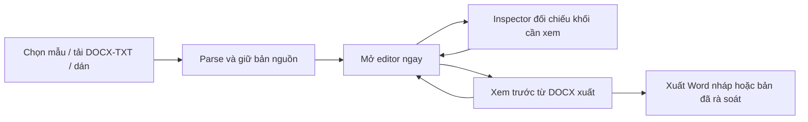

# Đánh giá bản tham khảo “DocForm 30 Studio v2.0”

> **Phương án chốt:** [Docs-ND30 — phương án sản phẩm và giao diện cuối cùng](./2026-10-15-final-product-interface-plan.md).

**Ngày:** 15/10/2026  
**Nguồn người dùng cung cấp:** `Văn bản đã dán.txt` và các tệp trong `C:\Users\Admin\.gemini\antigravity\brain\25526fc2-8342-4e87-9d8e-ee52908129bf\` gồm `Demo_Giao_Dien_Va_Workflow_DocForm30.md`, hai prototype HTML, hai ảnh chụp HTML, hai ảnh concept JPG. Đây là tài liệu tham khảo, không phải đặc tả đã được xác minh.  
**Đối chiếu:** [đề xuất sau nghiên cứu GitHub](./2026-10-15-github-reference-reassessment.md), giao diện local và mã Docs-ND30 `4bb714e`.

## 1. Phân loại bằng chứng

| Nội dung trong bộ tham khảo | Đã kiểm được từ tệp | Ý nghĩa |
| --- | --- | --- |
| Bố cục workspace ba vùng, mặt giấy A4, inspector, popup phân vùng | Có. Đã xem trực tiếp `demo_studio_edge.png`, `demo_import_studio_edge.png` và hai JPG. | Là ý tưởng hình ảnh/bố cục, chưa chứng minh hành vi app. |
| Chuyển chế độ NĐ30/HD05 và ẩn/hiện inspector | Có JavaScript minh họa trong `DocForm30_Studio_Prototype.html`: đổi vài nhãn/text và `display`. | Chỉ chứng minh tương tác nguyên mẫu. Không đổi mô hình tài liệu hay quy tắc xuất. |
| Soạn trực tiếp trên tờ A4 | HTML có lớp `editable-zone:hover`, nhưng không có `contenteditable`, `<input>` hay trình editor gắn vào vùng giấy. | Vùng giấy của prototype chưa chỉnh sửa được. |
| Đọc DOCX, tách 53 khối, giữ 57 ô bảng, “Zero Data Loss” | `DocForm30_Import_Studio_Prototype.html` là HTML tĩnh, không có mã tải/chọn tệp hoặc parser. Các con số và trạng thái được ghi sẵn. | Chưa có bằng chứng về phân tích hoặc bảo toàn tệp thật. |
| Xuất Word, AI và đổi mẫu | Hàm `mockExportDocx`, `triggerAiProofread`, `triggerAiFormalize`, `loadTemplate` chỉ hiển thị `alert`. | Chưa xuất tệp, chưa gọi AI, chưa đổi mẫu thật. |
| Tự lưu IndexedDB, lịch sử khôi phục | Hai HTML không sử dụng IndexedDB; các nhãn “đã lưu” và phiên bản nằm sẵn trong markup. | Chưa có lưu bền hoặc khôi phục. |
| “9/9 đạt”, “435 quy tắc”, “100% chuẩn”, “10 giây”, “80% thời gian” | Chỉ là chữ trên ảnh/HTML, không có kết quả kiểm định/đo thời gian. Catalog local có 435 rule, nhưng `canonicalAudit.ts` mặc định đánh dấu rule chưa được đánh giá là `NOT_EVALUATED`, không tính là PASS. | Không được hiển thị như cam kết sản phẩm. |

## 2. Đối chiếu bằng mắt với yêu cầu công ty

Ảnh chụp HTML thật (`demo_studio_edge.png`) cho thấy **tên Công ty Hoa tiêu Hàng hải miền Bắc bị xuống dòng thêm ở cuối** và quốc hiệu cột phải cũng gãy trước chữ “NAM”. Đây đúng là loại lỗi người dùng đã yêu cầu tránh khi dùng profile công ty theo tệp “Tiêu ngữ chuẩn.docx”. Mã hiện có tại `src/canonical/nd30/companyHeader.ts` dùng bảng OOXML rộng hơn vùng thân giấy, có độ thụt âm và giữ tên công ty/quốc hiệu theo cấu trúc gốc; vì vậy không nên lấy bố cục A4 trong HTML tham khảo làm mẫu chuẩn. Hai ảnh JPG là phối cảnh sinh tự động, chữ trong giấy bị méo và không dùng làm bằng chứng về thể thức văn bản.

Workspace ba cột ở ảnh 1600 px nhìn đầy đủ, nhưng cột trái giữ thường trực cả thư viện mẫu, tải tệp và AI; cột phải giữ thường trực kiểm định và lịch sử. Chúng chiếm nhiều bề ngang, trong khi công việc thường xuyên là đọc/sửa văn bản. Ở panel AI Studio và màn hình 900–1265 px, nên ưu tiên giấy/editor và mở inspector khi cần. Số mục cần xử lý vẫn phải nhìn thấy trên thanh trạng thái.

Popup đối chiếu song song giúp hiểu **khối nguồn được gán vào phần nào**, đặc biệt với bảng/phụ lục. Tuy nhiên một modal buộc người dùng xác nhận trước khi thấy editor sẽ thêm một cửa chặn vào bước 1, trái với yêu cầu “upload thì parse trực tiếp vào phần soạn thảo bên dưới”. Có thể đưa bản đồ nguồn vào inspector theo ngữ cảnh hoặc một chế độ đối chiếu mở khi cần; editor xuất hiện ngay sau khi parse.

## 3. Ý tưởng nên tiếp nhận và cách sửa

| Ý tưởng | Quyết định cho Docs-ND30 |
| --- | --- |
| Giấy A4 rõ ở trung tâm | Dùng chủ yếu tại **Xem trước & xuất**. Trong Soạn thảo, editor có bố cục dễ đọc và điều hướng theo phần; có thể làm vùng đầu/nội dung gần giấy A4 nhưng phải kiểm chứng soạn trực tiếp thật, caret, bảng, ngắt trang, màn hình hẹp và kết quả DOCX. Không biến một CSS canvas thành cam kết WYSIWYG. |
| Bản đồ khối nguồn → vùng tài liệu | Nhận. Hiển thị ở inspector: số khối, vị trí nguồn, vùng được gán, lý do và độ chắc chắn. Với bảng, hiển thị số hàng/cột và dấu hiệu ô hợp nhất; mục chưa phân loại vẫn được giữ và dẫn tới nguồn. |
| “Zero Data Loss” | Chuyển thành tiêu chí đo: mọi khối nguồn có ID và trạng thái `đã gán / chưa gán / không hỗ trợ`; đối chiếu thứ tự, số ô bảng, văn bản gốc và phụ lục trước/sau nhập trên bộ tài liệu thử. UI chỉ báo `Không phát hiện khối bị bỏ sót trong lần kiểm này` khi thật sự tính được. |
| Đổi NĐ30 / HD05 | Giữ lựa chọn chế độ ở cấp **tài liệu/profile**. Khi đổi chế độ của tài liệu đã soạn, cần chỉ rõ quy tắc/khối nào sẽ thay và lưu bản trước khi đổi. Không đổi riêng nhãn, màu và vài dòng chữ để tạo cảm giác tài liệu đã chuyển chuẩn. |
| AI sửa câu từ | Là hành động tùy chọn theo đoạn được chọn, có diff trước/sau và xác nhận của người soạn. Không mặc định sửa căn cứ pháp lý hoặc dữ kiện nghiệp vụ. |
| Lịch sử và tự lưu | Có giá trị cao, nhưng chỉ hiển thị `Đã lưu` khi giao dịch lưu thực sự hoàn tất. Cần thử F5, đóng/mở tab, lỗi quota, browser xóa dữ liệu, phiên bản schema và khôi phục. IndexedDB hỗ trợ lưu cục bộ nhưng [MDN nêu nguy cơ eviction/quota](https://developer.mozilla.org/en-US/docs/Web/API/Storage_API/Storage_quotas_and_eviction_criteria) và [giới hạn độ bền khi mất điện](https://developer.mozilla.org/en-US/docs/Web/API/IndexedDB_API/Using_IndexedDB); vẫn cần cách xuất bản sao dự phòng. |
| Kiểm định 9 trường và catalog 435 rule | Hiển thị `đạt / lỗi / cần người đối chiếu / chưa tự kiểm / không áp dụng` với mẫu số đúng. Không gom toàn bộ thành 100% PASS nếu rule chưa được chạy. |
| Màu navy, xanh lá, vàng | Có thể lấy cảm hứng cho UI, nhưng dùng màu theo vai trò và độ tương phản; không để sắc đỏ của chế độ Đảng thay cho xác nhận chế độ hoặc thay thể thức trên giấy. |

## 4. Workflow sau khi tham khảo

- **Soạn thảo** chứa bắt đầu, upload, parse, chỉnh sửa và đối chiếu. Inspector là ngăn phụ, không là bước bắt buộc hoặc modal chặn trước editor. Bố cục hai cột mặc định; ba cột chỉ khi cửa sổ đủ rộng.
- **Xem trước & xuất** là nơi duy nhất hiển thị toàn trang A4 và thao tác xuất. Bản xem HTML là tham khảo; tệp Word thực được đối chiếu bằng Word/bộ dựng tương đương trên các ca mẫu.
- **Bản nháp/lưu** có trạng thái trung thực; không ghi 100% đúng quy định chỉ vì các trường đã có chữ. Tài liệu Đảng và tài liệu hành chính giữ profile/rule tách biệt.

## 5. Điều kiện để thử tiếp ý tưởng “soạn trực tiếp trên giấy”

1. Dựng được một ca thật bằng editor hiện có, không phải HTML hover: chọn văn bản, gõ, undo/redo, chèn bảng, chuyển con trỏ qua đầu trang/thân/cuối và phụ lục.
2. Cùng nội dung xuất DOCX rồi mở bằng Microsoft Word/bộ dựng tương đương; đối chiếu tiêu ngữ công ty một dòng, quốc hiệu một dòng, số/ngày, bảng, ngắt trang và chữ ký.
3. Tại 620 và 390 px, người dùng vẫn đọc/gõ ở cỡ chữ hữu dụng, không phải thao tác trên tờ A4 thu xuống 45%.
4. Nếu không đạt các ca này, giữ editor cấu trúc riêng và Preview A4 riêng như [phương án hiện hành](./2026-10-15-github-reference-reassessment.md). Không cần thay lõi chỉ vì hình phối cảnh đẹp.

**Kết luận:** bộ tham khảo hữu ích cho hướng trực quan và đối chiếu nguồn; mức độ chức năng hiện tại là prototype hình ảnh. Các cam kết chất lượng, tốc độ, pháp lý và lưu bền phải được thay bằng tiêu chí đo và kiểm tra trên tệp thật trước khi đưa vào giao diện người dùng cuối.
