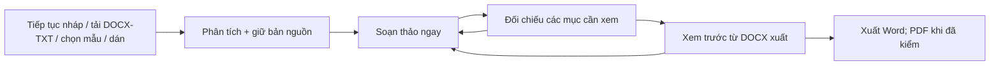

# Docs-ND30 — đánh giá lại thiết kế sau nghiên cứu dự án GitHub

> **Phương án chốt:** [Docs-ND30 — phương án sản phẩm và giao diện cuối cùng](./2026-10-15-final-product-interface-plan.md).

> **Nguồn tham khảo mới:** [Đánh giá bộ concept “DocForm 30 Studio v2.0” do người dùng cung cấp](./2026-10-15-external-studio-concept-review.md). Ý tưởng giấy A4 và bản đồ khối nguồn được tiếp nhận có điều kiện; các tuyên bố chức năng trong concept chưa phải kết quả kiểm thử.

**Ngày nghiên cứu:** 15/10/2026  
**Đối tượng:** nhân viên nội bộ Công ty Hoa tiêu Hàng hải miền Bắc  
**Phạm vi:** đề xuất sản phẩm và khả năng tái sử dụng; không thay mã ứng dụng.  
**Cơ sở hiện trạng:** quan sát trực tiếp giao diện ở 1265, 900, 620 và 390 px trong [đề xuất trước](./2026-10-15-end-user-interface-proposal.md); đọc `package.json`, `src/App.tsx`, `src/components/ND30Editor.tsx`, `src/components/A4DocumentPreview.tsx`, `src/utils/localFileImport.ts`, `src/server/blockExtractor.ts`, `src/utils/docxExport.ts`. Local đang ở `4bb714e`. Nghiên cứu repository và tài liệu gốc trên GitHub ngày 15/10/2026.

## 1. Kết luận lựa chọn

**Chọn phương án B: giữ lõi tài liệu và xây lại lớp giao diện theo tác vụ.** Docs-ND30 cần là công cụ tạo, chuẩn hóa và xuất một văn bản hành chính đáng tin cậy. Nó không cần trở thành bộ Office tổng quát hay hệ thống lưu trữ tài liệu. Tận dụng Tiptap, bộ phân vùng/nguồn gốc dữ liệu, catalog NĐ30, `docx` và `docx-preview` đã có; tổ chức lại quanh các việc người dùng thực sự làm. Tái sử dụng chọn lọc thành phần Tiptap UI khi tương thích được xác nhận. Học cách Paperless-ngx đặt nguồn, metadata, việc cần làm và phiên bản cạnh nhau; không sao chép mã GPL của nó.

Ba phương án được đối chiếu:

| Phương án | Lợi ích | Giá phải trả | Quyết định |
| --- | --- | --- | --- |
| A. Chỉ chỉnh CSS và tên nút hiện tại | Ít thay đổi, làm nhanh | Vẫn còn luồng dài, trạng thái nhập mơ hồ, dữ liệu sửa ở nhiều chỗ, toolbar tràn | Không đủ |
| **B. Giao diện theo tác vụ trên lõi hiện có** | Giữ profile/rule và luồng DOCX đã xây; giảm số quyết định trên màn hình; có thể triển khai từng lát | Cần tái cấu trúc `App.tsx`, trạng thái tài liệu và thành phần giao diện | **Đề xuất** |
| C. Thay editor/engine bằng ONLYOFFICE hoặc SuperDoc | Tiềm năng trung thực DOCX cao hơn với tài liệu phức tạp | Tích hợp, hạ tầng/giấy phép, chuyển dữ liệu/rule, thử lại toàn bộ luồng lớn | Chỉ nghiên cứu thử nghiệm nếu đo được lỗi trung thực DOCX không thể khắc phục với lõi hiện tại |

## 2. Dự án tham chiếu và khả năng reuse

“Trưởng thành” ở đây xét thời gian tồn tại, duy trì, tài liệu, hệ sinh thái và mức độ khớp bài toán; số sao GitHub không chứng minh tính đúng đắn của văn bản NĐ30. Thông tin chức năng/giấy phép dưới đây lấy từ repository của tác giả; đây là đánh giá kỹ thuật, việc dùng thư viện vẫn cần kiểm lại giấy phép của phiên bản cụ thể.

| Dự án | Có thể học / tái sử dụng | Ranh giới cần giữ | Kết luận |
| --- | --- | --- | --- |
| [Tiptap](https://github.com/ueberdosis/tiptap), MIT | Lõi editor dạng headless, extension và command. Docs-ND30 đang dùng `@tiptap/react` 3.x: giữ editor, thiết kế toolbar theo đúng tác vụ văn bản hành chính. | Phần Pro như conversion, versioning, comments có thuê bao; Tiptap không tự tạo DOCX chuẩn NĐ30. | **Giữ và khai thác tốt hơn.** |
| [Tiptap UI Components](https://github.com/ueberdosis/tiptap-ui-components), MIT cho các thành phần công khai | Tham khảo/cân nhắc button, dropdown, toolbar, tooltip, bố cục responsive của Simple Editor. | [Tài liệu chính thức](https://github.com/ueberdosis/tiptap-docs/blob/main/src/content/ui-components/getting-started/overview.mdx) còn ghi một số component hợp với React 18 hơn; Docs-ND30 dùng React 19. Không chép nguyên template trước khi thử tương thích và bàn phím. | **Thử từng thành phần**, ưu tiên pattern hơn là thay cả editor. |
| [Paperless-ngx](https://github.com/paperless-ngx/paperless-ngx), GPL-3.0 | Tham khảo luồng tiếp nhận tài liệu, chi tiết tài liệu, version và chỉnh metadata cạnh nguồn. [Usage](https://docs.paperless-ngx.com/usage/) mô tả document detail, lịch sử và các version của tệp; [screenshots](https://docs.paperless-ngx.com/) thể hiện chỉnh cạnh bản xem. | Là hệ quản lý/lưu trữ tài liệu, không phải editor văn bản hành chính. Không chép mã GPL vào ứng dụng; chưa có yêu cầu xây kho lưu trữ. | **Học mô hình tác vụ/trạng thái**, không thêm toàn bộ DMS. |
| [Mammoth](https://github.com/mwilliamson/mammoth.js), BSD-2-Clause | Chuyển DOCX thành HTML có ngữ nghĩa, style maps, cảnh báo chuyển đổi. API server hiện dùng Mammoth; có thể dùng làm tín hiệu đối chiếu khi nguồn Word có style rõ. | Chính README nói bỏ nhiều chi tiết trình bày, tài liệu phức tạp có thể chuyển chưa hoàn hảo; HTML phải được làm sạch trước khi hiển thị. Luồng tải local đang dùng bộ OOXML riêng, không phải Mammoth. | **Giữ vai trò bổ trợ**, không dùng HTML của Mammoth làm nguồn sự thật về bố cục. |
| [docxjs / docx-preview](https://github.com/VolodymyrBaydalka/docxjs), Apache-2.0 | Xem bản DOCX đã tạo ngay trong trình duyệt; Docs-ND30 đang tạo blob bằng `docx` rồi `renderAsync` để hiển thị. | Tác giả nêu giới hạn bởi khả năng HTML; các sai khác căn lề, bảng, ngắt trang vẫn có thể xảy ra. Bản xem trên web không đủ để tuyên bố tệp Word trùng tuyệt đối. | **Giữ một viewer**, đối chiếu bằng Word/bộ dựng tương đương cho ca chuẩn. |
| [docx](https://github.com/dolanmiu/docx), MIT | Tạo Word bằng API có section, paragraph, table, header/footer; đã là engine xuất của Docs-ND30. [Quickstart](https://github.com/dolanmiu/docx/blob/master/docs/quickstart.md) minh họa xuất trên browser. | Mã ứng dụng vẫn phải lập quy tắc NĐ30, xử lý bảng dài, tiêu ngữ, ngắt trang. Thư viện không bảo đảm đầu ra đúng profile công ty. | **Giữ và chuẩn hóa profile đầu ra.** |
| [docx-templates](https://github.com/guigrpa/docx-templates), MIT | Tạo tệp từ mẫu Word đã duyệt; có thể thử riêng với biểu mẫu rất cố định, giúp giữ layout gốc. | Cơ chế template hỗ trợ biểu thức/JavaScript, cần chỉ nhận mẫu do quản trị viên kiểm soát; khó thay thế editor tự do và rule engine. | **Ứng viên thử nghiệm hẹp** cho biểu mẫu cố định, chưa thêm vào luồng mặc định. |
| [ONLYOFFICE DocumentServer](https://github.com/ONLYOFFICE/DocumentServer) và [web-apps](https://github.com/ONLYOFFICE/web-apps), AGPL-3.0 Community | Tham khảo cách tách engine, giao diện, tích hợp; mạnh ở chỉnh/sửa/xuất DOCX và cộng tác. Repository nêu Community Edition tự triển khai, có giới hạn khuyến nghị và điều kiện giấy phép. | Cần dịch vụ riêng, tích hợp API/callback và xem xét nghĩa vụ giấy phép; UI Office đầy chức năng sẽ làm loãng luồng NĐ30 cho người dùng nội bộ. | **Không chọn làm nền UI hiện tại.** Chỉ thử nếu yêu cầu sửa DOCX nguyên dạng trở thành mục tiêu chính. |
| [SuperDoc](https://github.com/superdoc/docx-editor), AGPL-3.0 hoặc thương mại | Ứng viên đáng quan sát về editor OOXML trực tiếp, giữ section/header/footer/table trong mô hình tài liệu. | Mới hơn các nền trên, đổi mô hình dữ liệu lớn và cần xem giấy phép cho cách triển khai của công ty. Chưa có bằng chứng nó giải được bộ ca NĐ30 của Docs-ND30. | **Theo dõi/thử benchmark riêng**, không tích hợp theo cảm tính. |

Điểm quan trọng của mã hiện tại: `parseLocalFile()` gọi `extractBlocksFromDocx()` rồi `segmentSourceBlocks()`. Bộ tách riêng này giữ thứ tự khối, bảng và thông tin nguồn cho việc đối chiếu. `Mammoth` ở `server.ts` và kiểm thử; vì thế không nên mô tả Mammoth là lõi import local. `A4DocumentPreview.tsx` dựng lại blob từ `docxExport.ts` rồi xem bằng `docx-preview`, có fallback CSS. Đây là nền có thể cải thiện từng ca, nhưng trạng thái UI phải phân biệt **“bản xem tham khảo”** và **“tệp Word đã đối chiếu bằng mắt”**.

## 3. Đề xuất giao diện sửa lại sau nghiên cứu

### 3.1. Kiến trúc màn hình

```text
TÀI LIỆU
├─ Soạn thảo                    ← bắt đầu, upload/parse, biên tập, rà soát ở cùng bước
│  ├─ Chưa có tài liệu: 3 cách bắt đầu trong viewport đầu
│  ├─ Có tài liệu: cấu trúc + editor
│  ├─ Cần đối chiếu: inspector theo ngữ cảnh, mở khi có việc/chọn một trường
│  └─ Nguồn: đoạn trích gốc chỉ đọc, xuất hiện trong inspector khi cần
├─ Xem trước & xuất             ← bản A4 duy nhất và hành động xuất duy nhất
└─ Tiện ích qua drawer/menu
   ├─ Lịch sử bản nháp
   ├─ Quy tắc và lý do cảnh báo
   ├─ Thiết lập profile công ty (người có quyền)
   └─ Trợ giúp
```

**Điều chỉnh so với phác thảo trước:** hai màn hình chính được giữ, nhưng **không ép ba cột thường trực từ 1280 px**. Ở 900–1439 px chỉ hiển thị cấu trúc gọn + editor; inspector đối chiếu mở dạng drawer hoặc panel thay thế cấu trúc. Ba cột chỉ hợp lý khi cửa sổ rất rộng (khoảng 1440 px trở lên) và editor vẫn đủ chỗ. Quan sát ở 1265 px cho thấy chiều rộng và chiều cao hữu ích có hạn, đặc biệt trong Preview AI Studio.

### 3.2. Màn hình bắt đầu

1. Nếu có bản nháp lưu bền, hiện `Tiếp tục bản nháp` cùng thời gian lưu rõ ràng. Không ghi `Đã lưu` khi chỉ giữ trạng thái trong phiên trình duyệt.
2. Ba lựa chọn hiện ngay: `Tải DOCX/TXT`, `Chọn mẫu`, `Dán văn bản`. Không bày 10 mẫu trước nút tải. Mức nhấn thị giác của ba lựa chọn nên được quyết định bằng quan sát tần suất dùng thực tế; chưa có dữ liệu để khẳng định người dùng thích upload hơn mẫu.
3. `Chọn mẫu` mở thư viện tìm kiếm/lọc theo loại văn bản; mỗi mẫu hiển thị tên, mục đích, cấu trúc chính và profile áp dụng. Không dùng card dài chỉ để đọc mô tả.
4. Sau upload, tài liệu mở vào editor; dòng trạng thái một hàng: `Đã đọc 59 khối · 3 mục cần đối chiếu`. Thông báo lỗi phải cho biết giữ bản nháp trước đó và cách thử lại.

### 3.3. Không gian soạn thảo

```text
┌ Tên tài liệu · Đang lưu/Đã lưu thật ───── Lịch sử · Trợ giúp ┐
│ Soạn thảo                  Xem trước & xuất                  │
│ Nguồn: 01_Pham...docx · Hành chính NĐ30 · 3 mục cần xem       │
├───────────────┬──────────────────────────────────────────────┤
│ Phần đầu   2  │ Thanh công cụ gọn: Hoàn tác / kiểu đoạn /   │
│ Nội dung   0  │ đậm-nghiêng / căn / bảng / Chèn thêm        │
│ Phần cuối  1  │                                              │
│ Phụ lục    0  │ Một ô sửa cho mỗi trường và nội dung         │
│ Khác       0  │                                              │
├───────────────┴──────────────────────────────────────────────┤
│ 3 mục cần đối chiếu                    Xem trước bản nháp    │
└──────────────────────────────────────────────────────────────┘
```

- **Phần đầu:** profile công ty mặc định và bị khóa ở các thông tin nhận dạng chuẩn; số/ký hiệu, ngày, tên loại, trích yếu là trường riêng có nhãn và ví dụ. Nếu chọn văn bản Đảng thì profile khác hoàn toàn; không tự dùng quy tắc dấu/gạch của văn bản Đảng cho công ty.
- **Nội dung:** editor Tiptap chiếm diện tích chính. Toolbar chỉ để lệnh dùng thường xuyên; nhóm `Chèn` chứa các khối văn bản hành chính. Từ trường trong panel kiểm tra đi tới đúng vị trí trong editor.
- **Phần cuối và phụ lục:** mỗi thành phần có trạng thái nguồn và sửa độc lập. Không tự phát sinh `Nơi nhận` hoặc người ký nếu nguồn nhập thiếu. Phụ lục có danh sách, editor trực quan và khả năng hoàn tác xóa; không để HTML thô là cách dùng mặc định.
- **Inspector khi cần:** thẻ `Nguồn ghi`, `Bản đang soạn`, `Vì sao cần xem`, `Chấp nhận/Sửa`. Đoạn nguồn chỉ đọc là bằng chứng, không phải ô thứ hai để chỉnh cùng dữ liệu. Mỗi xác nhận lưu người xác nhận/thời điểm khi nền lưu bền tồn tại.

### 3.4. Xem trước và xuất

- Chỉ một viewer A4, dựng từ blob DOCX thực sẽ tải. Nút `Vừa trang`, `Đọc 100%`, chuyển trang và trạng thái `Bản nháp` ở một thanh gọn. Không lộ tên engine hoặc mở modal A4 thứ hai.
- Bảng bên cạnh nêu `Cần sửa`, `Cần người đối chiếu`, `Chưa kiểm tự động`, `Đã đạt`; mỗi mục có `Sửa` quay lại đúng trường. Không dùng tỷ lệ % bao trùm khi phần lớn rule chưa được đánh giá.
- Hành động chính `Xuất Word nháp` hoặc `Xuất Word` phản ánh trạng thái. PDF là hành động phụ sau khi đầu ra PDF được kiểm bằng mắt trên các ca chuẩn; chỉ báo thành công khi tệp tải được tạo xong.
- Bản xem HTML của `docx-preview` là **ước lượng hữu ích**, không tuyên bố trùng Word đến từng mm. Tiêu ngữ, bảng, ngắt trang, chữ ký và phụ lục cần bộ ca đối chiếu tệp xuất bằng Word/bộ dựng tương đương trước khi phát hành.

### 3.5. Menu, màu sắc, responsive

- Giữ màu vai trò của [đề xuất trước](./2026-10-15-end-user-interface-proposal.md#6-màu-sắc-chữ-và-khoảng-cách): xanh dương hành động, xanh lá kết quả tốt, vàng cần đối chiếu, đỏ lỗi. Đây là màu UI; trang A4 theo quy định văn bản, không tô theo thương hiệu.
- Header chỉ chứa tên tài liệu, trạng thái lưu thật, `Lịch sử`, `Trợ giúp` và menu `⋯`. Xuất tệp chỉ ở màn Xem trước. Các thuật ngữ `AI`, `HTML`, `engine`, mã rule nằm trong menu nâng cao/chi tiết.
- Ở 620 và 390 px: một cột, điều hướng vùng bằng menu, toolbar một hàng có `Thêm`, inspector toàn màn hình, Preview có hai chế độ `Vừa trang` và `Đọc 100%`. Không thu văn bản A4 thành chữ 6–7 px rồi coi đó là chế độ đọc.

## 4. Workflow và trạng thái cần triển khai theo thứ tự



1. **Nguồn & parse:** `Đang đọc` → `Đã đọc` / `Không đọc được`; không mất bản đang soạn khi một tệp mới lỗi. Phân biệt tên tệp, loại văn bản, số khối, trường nhận diện và trường chưa xác nhận.
2. **Biên tập:** `Có thay đổi chưa lưu` → `Đang lưu` → `Đã lưu bền` / `Lỗi lưu`. Nếu bản nháp vẫn chỉ ở bộ nhớ phiên, UI phải ghi `Chưa lưu trên thiết bị` thay vì báo đã lưu.
3. **Đối chiếu:** `Cần sửa` khác `Cần xác nhận`; `Chưa tự kiểm` khác `Đạt`. Sửa nội dung sau khi xác nhận phải làm mục liên quan trở lại `Cần đối chiếu`.
4. **Preview:** chỉ phản ánh trạng thái và nội dung của cùng một phiên bản DOCX sẽ xuất. Có đường quay về đúng trường từ bảng kiểm.
5. **Xuất:** tên tệp và nhãn `bản nháp`/`đã đối chiếu` rõ ràng; việc xuất không tự biến tài liệu thành “đã đạt quy định”.

## 5. Reuse thực tế và thứ tự quyết định

| Ưu tiên | Việc làm | Chỉ số quyết định |
| --- | --- | --- |
| 1 | Tái bố cục và trạng thái trên stack hiện có. Tách Start, Workspace, Preview, Inspector, History khỏi `App.tsx`. | Người dùng thực hiện trọn ba ca: chọn mẫu, tải DOCX có thiếu vùng, dán văn bản; không cần tìm editor bằng cuộn dài; mỗi trường chỉ sửa ở một nơi. |
| 2 | Thử một số thành phần Tiptap UI trên React 19 trong nhánh/probe riêng; chỉ nhận component nào qua kiểm bàn phím, focus, mobile và tương thích Tiptap 3. | Toolbar một hàng ở 620 px; không lỗi focus/selection; không làm thay đổi HTML/DOCX đầu ra. |
| 3 | Bộ ca đối chiếu DOCX: tiêu ngữ chuẩn, cơ quan hai dòng, bảng nhiều trang, chữ ký/nơi nhận, phụ lục, nguồn TXT. Đo mức lệch giữa Preview, Word và PDF. | Chỉ xem xét thay engine nếu sai khác có tính hệ thống, ảnh hưởng tệp cuối và không sửa ổn định bằng pipeline hiện tại. |
| 4 | Nếu ca biểu mẫu cố định cần giữ nguyên layout, thử `docx-templates` với mẫu Word do quản trị viên duyệt; nếu cần editor DOCX nguyên dạng, benchmark SuperDoc/ONLYOFFICE riêng cả kỹ thuật, vận hành và giấy phép. | Quyết định bằng kết quả thử trên tài liệu nội bộ đã ẩn thông tin nhạy cảm, không dựa vào screenshot/demo của dự án ngoài. |

**Không đưa mã Paperless-ngx, ONLYOFFICE hoặc SuperDoc trực tiếp vào Docs-ND30 chỉ để lấy kiểu giao diện.** Pattern có thể học; code/engine và nghĩa vụ giấy phép cần xem riêng. Bản phác thảo HTML trước vẫn có giá trị để thảo luận, nhưng quy tắc responsive được sửa như mục 3.1 và nhãn Preview được sửa như mục 3.4. Đây là đề xuất để người dùng kiểm tra hướng thiết kế, chưa phải kết quả triển khai.
